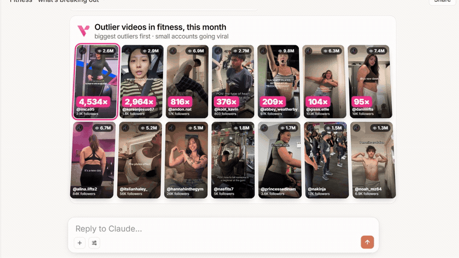
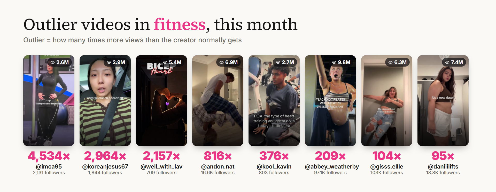
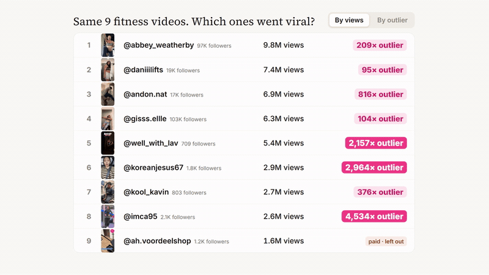
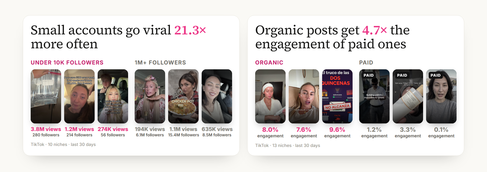
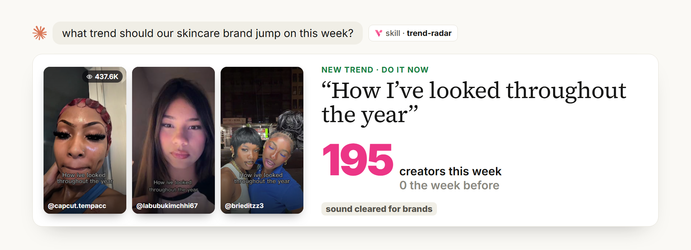
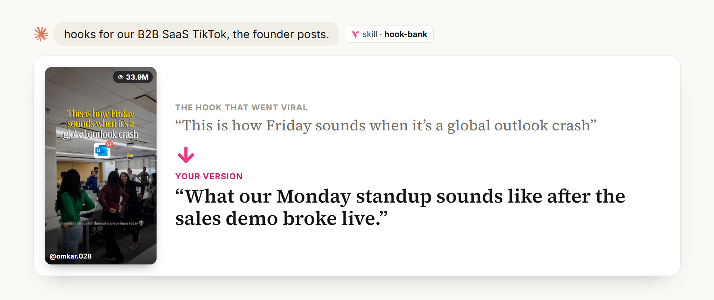
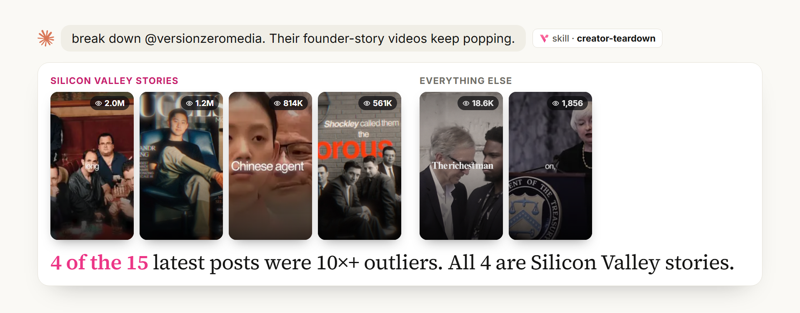
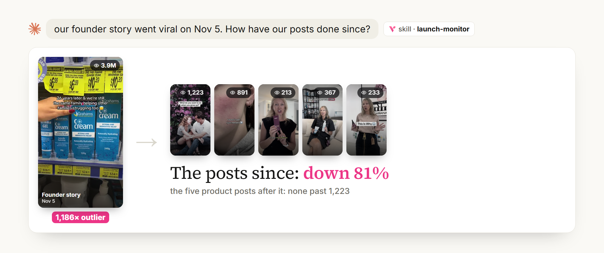
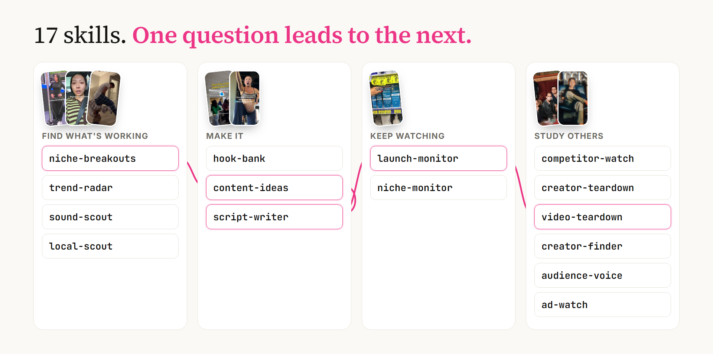

<h1 align="center">Social Media Skills for Claude Code, Cursor &amp; AI Agents</h1>

<p align="center">
  <strong>Social Media Skills is a free, open-source set of 17 Claude skills from Virlo that tell your AI agent what's breaking out on TikTok, Instagram Reels and YouTube Shorts, why it worked, and what to post next.</strong><br />
  Virlo is social listening for TikTok, Instagram Reels and YouTube Shorts. Virlo searches a database of 23M+ social videos. Last month, across 131,050 TikToks in 10 niches, accounts with under 10,000 followers made 68.8% of the outlier videos.
</p>

<p align="center"><sub>Updated Nov 23 2026 · MIT license · works in Claude Code, Claude.ai, Cursor, Codex, Gemini CLI and any agent that reads SKILL.md</sub></p>

<p align="center">
  <a href="https://github.com/Virlo-AI/social-media-skills/stargazers"></a>
  <a href="https://agentskills.io"></a>
  <a href="https://dev.virlo.ai/docs/skills?via=skills&utm_source=github&utm_medium=readme&utm_campaign=social-media-skills"></a>
  <a href="LICENSE"></a>
</p>

<p align="center">
  <a href="#how-do-i-install-these-claude-skills">Install</a> ·
  <a href="#which-social-media-skills-are-included">The 17 skills</a> ·
  <a href="examples/README.md">24 real reports</a> ·
  <a href="#how-does-virlo-measure-a-viral-breakout">How we measure</a> ·
  <a href="#faq">FAQ</a>
</p>



## What do these Claude skills do?

These Claude skills turn a plain question ("what's breaking out in fitness right now?") into a sourced report built on Virlo's live TikTok, Reels and Shorts data: the outlier videos, the patterns behind them, and what to film next.



```text
> what's breaking out in fitness right now, and why?

Fitness breakouts this month are short gym moments from tiny accounts and milestone vlogs:
8 measured breakouts ran at 95× to 4,534× outlier.
Top breakouts: @imca95 4,534× (new gym routine reveal) · @koreanjesus67 2,964× · @well_with_lav 2,157×
Make next: film the class you teach, handheld, about 30 s (handheld vlogs climbing 11.7% → 25.6% of posts)
Stop: talking-head videos (0.77×) and "here's my routine" tutorial promises (0.77×) are under
3 searches of 11,819 fitness videos since Oct 24 · 8 breakouts measured · Spent $0.23
Report: virlo-research/2026-11-23-niche-breakouts-fitness.md
```
<sub>From a real run on Nov 23 2026. [Read the full report](skills/niche-breakouts/samples/fitness.md): every video linked, every number sourced.</sub>

The [full report](skills/niche-breakouts/samples/fitness.md) behind that answer gave three things to film this week, what to stop doing, and the proof behind each. **See all [24 real reports](examples/README.md)** across fitness, skincare, personal finance, B2B SaaS, local cafés and sounds, each with its sources and what it cost.

## Why not just ask Claude or ChatGPT what's trending on TikTok?

On its own, an AI model can't see this week's TikTok, Reels or Shorts videos, so it guesses or names old examples. Ask an AI "what's going viral in my niche?" and you get one of two answers. It guesses, because it can't see this week's videos. Or it lists the biggest videos, which mostly shows big accounts having a normal day. Neither tells you what to make.

The Virlo skills read Virlo's database of 23M+ analysed TikTok, Reels and Shorts videos, and answer like a good researcher would:



| Most "what's viral" answers | These skills |
|---|---|
| Rank by raw views | Measure each video against **its own creator** (its outlier multiple). A 2M-view post from a 10M-follower account is a normal day; in Virlo's fitness run, a new gym routine reveal was a **4,534× outlier**. |
| Count paid posts as viral | Pull **bought reach** out. In Virlo's scan of 1,726 high-reach TikToks across 13 niches, posts labelled paid earned a median 1.81% engagement against 8.53% for organic: 4.7 times less. |
| Say "use a strong hook" | Quote the **actual hooks** that worked in your niche, with their numbers, and rewrite them for you. |
| Tell you what's trending everywhere | Tell you what's **over-performing and under-supplied** in your niche, what's crowded, and what's fading. |
| Make up examples | **Link every video**, end every report with a sources table, and say what the run cost. |



You get things you can act on today: moves to film, hooks, scripts, sounds cleared for brands, a vetted creator shortlist, a competitor gap list.

## Which skill should I start with?

Start with niche-breakouts ("what's breaking out in my niche?"), then follow the next step each report suggests. By who you are:

| You are | Ask this first | Then |
|---|---|---|
| **A brand** | "Set up my brand", then "what's breaking out in my niche right now?" | "Which sounds can we use this week?" · "What do my competitors' best videos do differently?" |
| **An agency** | "Save a brief for my client <name>", then "what's breaking out in <client's niche>?" | "Find creators for this campaign" · "Show me <competitor>'s Meta ads" · "Watch this niche every week" |
| **A creator** | "What's breaking out in my niche?" | "Give me hooks for my next video" · "Why did this video go viral? <link>" · "How is my latest post doing?" |

## How do I install these Claude skills?

**Claude Code** (easiest: all 17 skills plus the Virlo MCP server, two lines):
```text
/plugin marketplace add Virlo-AI/social-media-skills
/plugin install social-media-skills@virlo
```

**Claude.ai** (3 steps):
1. Download the skill's folder and the `virlo-api` folder from this repo, and zip each one.
2. In Claude.ai, go to Settings → Capabilities, make sure code execution is on, and upload both zips under Skills.
3. Add the Virlo MCP as a custom connector: `https://dev.virlo.ai/api/mcp/mcp` ([guide](https://dev.virlo.ai/docs/mcp?via=skills&utm_source=github&utm_medium=readme&utm_campaign=social-media-skills)).

**Cursor, Codex, Gemini CLI, Windsurf, VS Code, Cline** (needs [Node 18+](https://nodejs.org)):
```bash
# All 17 skills
npx skills add Virlo-AI/social-media-skills

# Just one (always add virlo-api with it: it's the data layer every skill uses)
npx skills add Virlo-AI/social-media-skills --skill niche-breakouts --skill virlo-api

# See the list first
npx skills add Virlo-AI/social-media-skills --list
```

| Where you work | Where the skills go | How |
|---|---|---|
| **Claude Code** | `.claude/skills/` or `~/.claude/skills/` | the plugin above, or `npx skills add Virlo-AI/social-media-skills -a claude-code` |
| **Cursor** | `.cursor/skills/` or `.agents/skills/` | `npx skills add Virlo-AI/social-media-skills -a cursor` |
| **Codex, Gemini CLI, Windsurf, VS Code, Cline** | `.agents/skills/` | `npx skills add Virlo-AI/social-media-skills` ([skills.sh](https://skills.sh)) |
| **ChatGPT** | a project | Connect the Virlo MCP and paste the skill's `SKILL.md` into the project's instructions |

Each skill is one folder with a plain `SKILL.md` ([Agent Skills spec](https://agentskills.io)). Your agent keeps only each skill's short description in mind and opens the full instructions when your question matches.
## How do I connect Virlo, and what does it cost?

The Virlo skills are free; the data comes from Virlo's pay-as-you-go API: add $10 to start, with no subscription. Setup takes about 2 minutes: connect a Virlo key or the Virlo MCP.

1. **Sign up** at [dev.virlo.ai](https://dev.virlo.ai/?via=skills&utm_source=github&utm_medium=readme&utm_campaign=social-media-skills).
   - Pay as you go: add $10 to start. No subscription, and the balance never expires.
   - A full niche-breakouts run costs about $0.25, so $10 is about 40 runs.
2. **Create a key** at [dev.virlo.ai/dashboard/api-keys](https://dev.virlo.ai/dashboard/api-keys?via=skills&utm_source=github&utm_medium=readme&utm_campaign=social-media-skills), then:
   ```bash
   export VIRLO_API_KEY=virlo_tkn_...
   ```
   **Or skip the key and connect the MCP** (both use the same API balance). In Claude Code: `claude mcp add --transport http virlo https://dev.virlo.ai/api/mcp/mcp`. Other apps: [dev.virlo.ai/docs/mcp](https://dev.virlo.ai/docs/mcp?via=skills&utm_source=github&utm_medium=readme&utm_campaign=social-media-skills).

**No key or balance yet? Ask anyway.** Every skill answers with a real sample report, labelled as a sample, plus what your own run would cost, so you see what you'd get before you pay.

## Which social media skills are included?

The repo has 17 Claude skills for TikTok, Instagram Reels and YouTube Shorts research, grouped by job:

**Find what's working**



| Skill | Ask it | You get | Typical cost |
|---|---|---|---|
| niche-breakouts | "What's breaking out in my niche right now, and why?" | outlier videos, each against its own creator, the patterns behind them, 3 moves to make | ~$0.25 |
| trend-radar | "What should I jump on this week?" | Content Trends, Topic Trends and breakout sounds, ranked for you | ~$0.75 |
| sound-scout | "Which sounds are about to blow up?" | breakout sounds with example videos, checked for brand use | ~$0.75 |
| local-scout (beta) | "What's working for cafés in Melbourne?" | place-tagged breakouts and formats | ~$0.15–0.25 |

**Make it**



| Skill | Ask it | You get | Typical cost |
|---|---|---|---|
| hook-bank | "Give me hooks that work in my niche" | proven hooks with their numbers, rewritten for you | ~$0.50 |
| content-ideas | "What should I post next?" | 5 ideas, each built on named breakouts | free after niche-breakouts, else ~$0.25 |
| script-writer | "Write me scripts" | scripts and shot lists, each modelled on one breakout | ~$0.01 a script |

**Study others**



| Skill | Ask it | You get | Typical cost |
|---|---|---|---|
| competitor-watch | "What do my competitors' best videos do differently?" | their breakouts vs the rest, as a gap list | ~$0.03–0.06 |
| creator-teardown | "Break down this creator" | pillars, outliers, posting times, what to borrow | ~$0.04 |
| video-teardown | "Why did this video go viral?" | the breakdown plus a remix for you | ~$0.04 (+$0.50 full analysis) |
| creator-finder | "Find creators for my campaign" | a scored, vetted shortlist and a CSV | ~$0.10 |
| audience-voice | "What are viewers asking for in the comments?" | questions, objections and requests, quoted | ~$0.06 |
| ad-watch | "Show me this brand's Meta ads" | hooks, offers and what's new | ~$0.01–0.05 |

**Keep watching**



| Skill | Ask it | You get | Typical cost |
|---|---|---|---|
| launch-monitor | "How is my post doing?" | how far each post is an outlier on your account, plus comment sentiment | ~$0.01–0.05 a check |
| niche-monitor | "Watch this niche every week" | a Virlo research agent that collects every week; ask for the digest (or schedule the prompt) and get the 3 things to make | $0.50 a run |

**Setup and data**
| Skill | Ask it | You get | Typical cost |
|---|---|---|---|
| brand-brief | "Set up my brand" | `brief.md`, so every skill fits your audience, voice and avoid list | free |
| virlo-api | any Virlo data, raw | the data layer every skill uses | per call |

Every skill says its cost before it runs, asks before anything over $1 or anything recurring, and ends with what it actually spent.

## What can I ask?

Ask in plain words, the way you'd ask a researcher. For example:

```text
What's breaking out in "home workouts" on TikTok this month?
Give me 20 hooks that work for B2B SaaS talking-head videos, rewritten for us.
Which sounds are about to blow up that are safe for a family brand?
What do @competitor1 and @competitor2's best videos do that the rest don't?
Find 15 fitness creators between 20K and 300K followers who consistently post outlier videos.
What's working for cafés in Melbourne right now?
Why did this video go viral? https://www.tiktok.com/@someone/video/…
```

## How does Virlo measure a viral breakout?

Virlo calls a video a breakout when it's a 3× outlier or more, so big and small accounts are each measured against themselves.

**Outlier** = how many times more views a video got than its creator normally gets (judged on their other recent posts). After this, every report just says "outlier" or "N× outlier".

- **N× outlier** needs at least 3 of the creator's other recent posts to judge against.
  - **3× or more:** breakout.
  - **1.5× to 3×:** above typical.
  - **0.67× to 1.5×:** about typical.
  - **Under 0.67×:** below typical.
- **Across platforms and creator sizes,** we rank by **Virality Score** (VS: how far a video outran its creator's audience; 18 is strong, 35 and up is exceptional), never by raw views.
- **Content Trends** are formats and memes creators are copying right now. **Topic Trends** are subjects people are talking about. The skills never mix them up.
- **Patterns** (formats, hooks, sounds) count only when several creators use them. They're labelled **new**, **climbing**, **steady** or **fading** by comparing the last 30 days with the 90 before.

How every number is read: [skills/virlo-api/references/method.md](skills/virlo-api/references/method.md).

## How do the skills work together?



<details><summary>The same map as text</summary>

```text
brand-brief ──► every skill reads virlo-research/brief.md
virlo-api   ──► every skill calls Virlo through it (setup, costs, method, endpoints)

FIND WHAT'S WORKING              MAKE IT                          POST AND LEARN
niche-breakouts ──┬─► content-ideas ──► script-writer ──► launch-monitor ──► video-teardown
                  ├─► hook-bank ─────────────┘                                 (why it flew or flopped)
                  └─► audience-voice ──► content-ideas
trend-radar ──────► sound-scout ──► script-writer
competitor-watch ─┬─► video-teardown ──► script-writer
                  └─► ad-watch ──► hook-bank
creator-finder ───► creator-teardown ──► video-teardown
local-scout ──────► creator-finder · niche-monitor
niche-monitor ────► every week: content-ideas · video-teardown
```

</details>

Every arrow is a "→ next" a skill offers at the end of its report, so one question leads to the next.

## Design principles

- **Outliers, measured against each video's own creator**, never raw views.
- **Every number cited.** Every video is linked, and nothing is invented. Reports end with a sources table.
- **The cost up front,** and the actual spend at the end.
- **Reports saved to disk** (`virlo-research/`), so they're shareable and re-readable for free.
- **Public data only.** Never used to track a person.

## FAQ

**What are Claude skills?**
Claude skills are folders of instructions (a `SKILL.md` file plus any scripts) that Claude loads only when your request needs them. They follow the open Agent Skills format, so the same skills work in Claude Code, Claude.ai, Cursor, Codex and Gemini CLI. Virlo's social media skills teach your agent how to research TikTok, Reels and Shorts with real data.

**Is there a Claude skill for TikTok?**
Yes. Virlo's Social Media Skills include 17 Claude skills for TikTok research, which also cover Instagram Reels and YouTube Shorts: what's breaking out in a niche, trending sounds cleared for brands, proven hooks, why a video went viral, competitor and creator teardowns, and scripts. They read Virlo's live data instead of guessing.

**Are the skills free?**
Yes. The skills are MIT-licensed: use them, change them, ship them. The data comes from Virlo's API, which you pay per call with no subscription. Most runs cost between $0.01 and $0.90, and every skill tells you the price before it spends anything.

**Can I try it before I pay?**
Yes. Install the skills and ask a question with no key. You'll get a real sample report from the same skill, labelled as a sample, plus the setup steps.

**Which platforms does it cover?**
TikTok, Instagram Reels and YouTube Shorts, plus Meta ads (ad-watch).

**Do I need to know how to code?**
No. You type questions in plain words ("what should I post this week?"). In Claude Code the install is two lines (the plugin). Elsewhere it's one `npx` command, which needs Node 18 or newer.

**Does it work in Claude.ai, ChatGPT or Cursor?**
Yes. Claude Code, Cursor, Codex, Gemini CLI, Windsurf and VS Code load the skills directly. In Claude.ai: zip the skill's folder and the `virlo-api` folder, upload both under Settings → Capabilities → Skills, and add the Virlo MCP as a custom connector (`https://dev.virlo.ai/api/mcp/mcp`). In ChatGPT, connect the same MCP and paste the skill's `SKILL.md` into a project.

**Can Claude find trending TikTok videos?**
With these skills, yes. The trend-radar and niche-breakouts skills pull this week's Content Trends and breakout videos from Virlo's database of 23M+ social videos, link every video, and say how big an outlier each one is. Without live data, Claude can only guess.

**Can I use it for clients?**
Yes. Run `brand-brief` once per client, and every skill tailors its answer to that client's audience, voice and avoid list.

**Is my data safe?**
Your API key only ever goes in the request header to Virlo, and the skills never print or save it. The skills read public posts only and never build a profile of a private person.

## Data and method

- **Source:** Virlo's database of 23M+ analysed TikTok, Instagram Reels and YouTube Shorts videos, read through the public Virlo API (`api.virlo.ai`).
- **Sample reports:** real runs of these skills on Nov 23 2026 (one weekly digest from Nov 22), each with its prompt, every source video linked, and what it cost. Numbers are as of the run date.
- **Method:** "N× outlier" compares a video with its creator's other recent posts; Virality Score compares it with the creator's audience size. Full method: [method.md](skills/virlo-api/references/method.md).
- **How the reports are made:** an AI agent follows these skills step by step on live data; the reports are checked by the Virlo team. Nothing is mocked.
- **Limitations:** each report reads a sample (first pages of search, about 15-25 posts per creator), and short-form moves fast, so a run is a snapshot of that week.
- **Cite as:** Virlo, *Social Media Skills for Claude Code, Cursor & AI Agents*, November 2026, github.com/Virlo-AI/social-media-skills.

## Links

[Get a key ($10 to start)](https://dev.virlo.ai/?via=skills&utm_source=github&utm_medium=readme&utm_campaign=social-media-skills) · [Pricing](https://dev.virlo.ai/pricing?via=skills&utm_source=github&utm_medium=readme&utm_campaign=social-media-skills) · [API docs](https://dev.virlo.ai/docs?via=skills&utm_source=github&utm_medium=readme&utm_campaign=social-media-skills) · [MCP](https://dev.virlo.ai/docs/mcp?via=skills&utm_source=github&utm_medium=readme&utm_campaign=social-media-skills) · [All skills](https://dev.virlo.ai/docs/skills?via=skills&utm_source=github&utm_medium=readme&utm_campaign=social-media-skills)

## Contributing

Found a way to make a skill sharper, or have a new one? Open a PR. Read [AGENTS.md](AGENTS.md) first, and run `node scripts/validate.mjs` before you submit: it checks every endpoint against Virlo's live API spec.

## License

MIT
